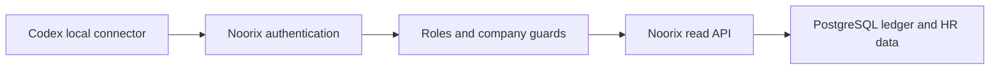

# عقد بناء اتصال Codex للقراءة — Noorix

## عقد البناء (G0)

### الهدف

توفير حساب تكامل وموصل Codex محلي يقرآن بيانات Noorix التشغيلية من جميع الشركات، من دون إنشاء أو تعديل أو حذف أي سجل. لا يُنشأ الحساب قبل إثبات أن API يرفض كل مسار كتابة له.

### المستخدم والنطاق

- المستخدم: مالك Noorix عبر Codex.
- البيانات: الشركات وبيانات الأعمال (اللوحات، المبيعات، الفواتير، المشتريات، الموردون، الخزائن، المصروفات، الأصول، الطلبات، HR، الرواتب، والتقارير) ضمن حدود الواجهات المقروءة.
- الشركات: كل الشركات النشطة التابعة للمستأجر وقت التزويد، وتُسند صراحة إلى حساب التكامل. لا تُلحق الشركة الجديدة تلقائياً؛ يسجل فحص دوري حالة عدم التطابق ويطلب إضافة صريحة من المالك.
- الاعتماد: حساب منفصل ودور مخصص `codex_readonly`. تحفظ بيانات دخوله محلياً فقط في Windows Credential Manager؛ لا تدخل Git أو السجل أو المحادثة.

### خارج النطاق

- أي إنشاء أو تعديل أو حذف، بما فيه إدارة المستخدمين والأدوار والشركات وإعدادات النظام والنسخ والأسرار.
- استعمال دور `owner` أو `super_admin`، أو استعمال جلسة المدير في المتصفح أو استخراج رموزها.
- النشر للإنتاج قبل Pull Request ومراجعة التسليم المعتمدة.

### معايير القبول

1. الحساب لا يملك `*_WRITE` أو `*_DELETE` أو `MANAGE_*` أو `CREATE_*` أو أي صلاحية عمل تشغيلي.
2. تفصل الخلفية كل مسار تعديل كان محمياً خطأ بصلاحية قراءة: كشوف البنك، تقويم لوحة التحكم، وإشارة المورد (bookmark).
3. الموصل المحلي لا يقبل إلا `GET` ضمن allowlist محدد، وبحدود صفحات وحجم نتيجة ومهلة وسجل منقح بلا أسرار.
4. يثبت اختبار إيجابي قراءة كل مجال مقرر، واختبار سلبي يثبت رفض `POST` و`PUT` و`PATCH` و`DELETE` قبل حفظ الاعتماد.
5. تعطيل الحساب يمنع الدخول والتجديد فوراً؛ وقد يبقى access JWT صادر سابقاً صالحاً حتى مدة `JWT_EXPIRES_IN` الحالية (الافتراضي الموثق 8 ساعات) ما لم تُعتمد آلية إبطال فوري في شريحة مستقلة. توسيع الصلاحية لاحقاً يتطلب عقداً وموافقة منفصلين.

### قرار المسار المباشر

المصدر الحالي لا يملك دور «قراءة كاملة» آمن: `VIEW_REPORTS_BANK` و`VIEW_DASHBOARD` وبعض صلاحيات القراءة تسمح بمسارات تعديل. أقصر طريق صحيح هو فصل صلاحيات الكتابة الثلاث المذكورة، ثم استخدام دور مخصص محدود وعميل محلي يرسل GET فقط. لا نستخدم دور المالك ولا نبني خدمة عامة جديدة.

### خريطة ERP والرقابة

الموصل مستهلك لحقائق الخلفية فقط. مصدر الأرقام يظل PostgreSQL/ledger ولقطات HR وخدمات Noorix؛ لا يحسب الموصل راتباً أو ضريبة أو رصيداً، ولا ينشئ مستنداً أو قيداً أو يعتمد أو يلغي عملية. التزامن والإقفال والتدقيق المالي تبقى في الخلفية.

## سجل البوابات

| البوابة | الحالة | المالك | المراجع المستقل | الدليل |
|---|---|---|---|---|
| G0 الحوكمة والعقد | معتمدة | قائد البناء | حارس البوابات | هذا العقد وقراءة الصلاحيات والمصادقة |
| G1 السعة والنمو | معتمدة | مهندس السعة | كبير المعماريين | ملف السعة أعلاه |
| G2 المعمارية والعقود | معتمدة | كبير المعماريين | خبير ERP/السعة | حد API وسياسة migration أعلاه |
| G3 التقنية والمكتبات | معتمدة | أمين المكتبات | كبير المعماريين | لا اعتماد جديد؛ أدوات ومكتبات قائمة |

## ملف الإطلاق والنمو (G1)

| البند | القرار أو الافتراض المحافظ |
|---|---|
| المستخدمون | حساب تكامل محلي واحد للمالك؛ طلب واحد متزامن افتراضياً، وسقف عميل 2 طلبات متوازية. |
| الرحلات الحرجة | تحقق الهوية، قراءة الشركات، وقراءة بيانات الأعمال أو HR أو التقرير بترقيم صفحات. |
| البيانات | النتائج المحددة بصفحة لا تتجاوز 100 سجل أو 2 MiB؛ لا تُنزّل ملفات كشوف أو مرفقات ولا تسجل بيانات موظفين كاملة. |
| الأداء | مهلة 15 ثانية لكل طلب؛ يهدف الموصل لوقت قراءة عادي أقل من 2 ثانية، ويعرض فشلاً منقحاً بدلاً من إعادة محاولة غير محدودة. |
| التزامن | لا كتابة من الموصل، لذلك لا يملك مسار تضارب أو منع تكرار مالي. قراءة البيانات متسقة بحدود استجابة API. |
| الاستمرارية | تعطيل الحساب يوقف refresh التالي؛ الاعتماد في Windows Credential Manager؛ لا cache في الموصل ولا تخزين بيانات الأعمال. |

لا يوجد فحص حمل: الاستخدام الفعلي للمالك قراءة تشخيصية متقطعة لمستخدم واحد، ولا خطر جديد غير مغطى بحدود API والصفحات يستدعي تشغيل حمل على بيئة مشتركة أو إنتاج.

## معمارية البيانات والعقود (G2)

### حدود المكونات

```text
Codex local MCP (GET allowlist فقط)
  -> Windows Credential Manager (حساب codex_readonly)
  -> Noorix /api/v1/auth/login ثم JWT/refresh محليان
  -> Noorix API + RolesGuard + CompanyAccessGuard
  -> PostgreSQL / ledger / HR snapshots (مصدر الحقيقة)
```



**مثبت بالدليل:** حراس الصلاحيات وعضوية الشركات قبل controllers في `backend/src/auth/guards`، ومسارات Nest في controllers، وترحيل Prisma في هذا المرشح. **افتراض تشغيل:** TLS وproxy الطرفي خارج هذا المستودع ويجب التحقق منهما عند النشر.

- الحساب دور مخصص، لا `owner` ولا `super_admin`، وتُسند له كل company IDs النشطة عند الإنشاء. الشركات الجديدة تحتاج إضافة مقصودة للحساب عبر مدير النظام، مع سجل قبل/بعد وموافقة المالك؛ لا امتياز شامل صامت أو enrollment تلقائي.
- الاستثناءان الوحيدان لقاعدة GET هما `POST /api/v1/auth/login` و`POST /api/v1/auth/refresh`: يستخدمان فقط للحصول على أو تجديد JWT للحساب المخصص. يعترف العقد بأنهما يحدثان `lastActivityAt` وسجل تدقيق للمصادقة؛ لا يحملان بيانات أعمال ولا ينفذان تغيير أعمال.
- بعد المصادقة لا يقبل الموصل إلا GET من قائمة المسارات التالية، مع `companyId` صريح حيث يطلبه API، وترقيم/حد أقصى 100 عند توفره: `companies`، `dashboard/overview`، `dashboard/ledger-reconciliation`، مسارات GET للتقويم، `owner`، `sales`، `invoices`، `purchase-debts`، `suppliers`، `categories`، `accounts`، `vaults`، `expense-lines`، `company-assets`، `orders-v4` و`orders-v4/reports/*`، `employees`، مسارات GET في `hr`، `reports`، `ledger`، `reporting/insights`، `vat-planning`، وGET في `bank-statements`.
- يستبعد الموصل صراحةً المسارات التي تحمل ملفات أو وثائق أو تحميلات/مرفقات HR، و`backup` و`users` و`roles` و`settings` وعمليات `chat`، حتى إن ظهر endpoint قابل للقراءة.
- حدود API المطلوبة قبل توفير الدور:
  - إضافة `BANK_STATEMENTS_WRITE`، وتحويل كل `POST`/`PATCH`/`DELETE` في `bank-statements` إليه؛ تبقى `GET` على `REPORTS_READ` أو `VIEW_REPORTS_BANK`.
  - إضافة `DASHBOARD_CALENDAR_WRITE` وتحويل تعديلات تقويم dashboard إليه؛ تبقى `GET` على `VIEW_DASHBOARD` أو `REPORTS_READ`.
- إضافة `SUPPLIERS_BOOKMARK_WRITE` وتحويل `PATCH /suppliers/:id/bookmark` إليه.
- **سياسة التوافق المعتمدة من المالك:** تحافظ migration واحدة على قدرة كل الأدوار الموجودة وقت النشر: تضيف صلاحية الكتابة الجديدة للدور الذي كان يملك صلاحية القراءة/العرض القديمة المطابقة. لا تُمنح هذه الصلاحيات تلقائياً لأي دور ينشأ بعد migration؛ يمنحها مدير النظام صراحة. ينشأ `codex_readonly` بعد migration فلا يرث أياً منها.
- لا يتغير مصدر الأرقام أو الحسابات أو قيود ERP. التغيير يفصل تفويض مسار HTTP فقط.
- المراقبة: تعتمد الخلفية سجلات التدقيق الموجودة للمصادقة ومسارات الأعمال، ويضيف الموصل سجل عمليات محلياً منقحاً بالمسار والحالة فقط، بلا headers أو رموز أو payload حساس.
- التراجع: عكس حراس الصلاحيات في commit لاحق إن لزم، أو تعطيل حساب `codex_readonly` لمنع الدخول والتجديد من دون مس بيانات أعمال. لا يدعي العقد إبطال access JWT سابق فوراً؛ سقفه مدة access token الموثقة.

## التقنية والمكتبات (G3)

- الرصة: NestJS وPrisma وReact الحالية؛ لا مكتبة ولا خدمة ولا schema جديدة لفصل الصلاحيات.
- الموصل المحلي: يعاد استخدام PowerShell 7 وWindows Credential Manager الموجودين على جهاز المالك، من دون حزمة إضافية أو مستمع شبكة.
- الاختبارات: Jest الحالي لحراس/واجهات HTTP، واختبارات PowerShell غير شبكية للـallowlist ورفض verbs؛ تفحص الاختبارات عدم وجود أي طلب شبكة تعديل.
- البديل المرفوض: حساب `owner` أو `super_admin` مع حظر محلي فقط، لأنه يبقى قادراً على تجاوز العميل واستدعاء API المعدّل مباشرة.

## قرار بوابات مبدئي

G0 وG1 وG2 وG3 تحتاج مراجعة مستقلة قبل تعديل الخلفية أو إنشاء الحساب. لا يُبدأ بناء الموصل أو التزويد الخارجي قبل اعتمادها.

## دفتر العمليات الحي

| المعرّف والوقت | البوابة | النوع | النية أو السبب | النتيجة والدليل | الأثر والتراجع | المنفذ/المراجع |
|---|---|---|---|---|---|---|
| L01 2026-11-05 | G0 | قراءة | فهم حدود API قبل منح وصول | قراءة `docs/PERMISSIONS.md` وعقود مصدر الحقيقة وauth/users/roles/controllers | قراءة فقط؛ لا تغيير | قائد البناء / قيد المراجعة |
| L02 2026-11-05 | G0 | قرار | تطبيق طلب المستخدم: قراءة فقط الآن | استبعاد المالك/المشرف والإدارة والأسرار؛ الدور المقترح `codex_readonly` | قابل للتراجع بحذف الفرع؛ لا حساب بعد | قائد البناء / قيد المراجعة |
| L03 2026-11-05 | G0 | مراجعة مستقلة | اختبار صلاحيات القراءة قبل إنشاء الحساب | المراجع أثبت فجوات: bank statement والتقويم وbookmark تستخدم صلاحيات قراءة لمسارات تعديل | يمنع إنشاء الحساب حتى إصلاحها | حارس البوابات / مراجعة مستقلة |
| L04 2026-11-05 | G1–G3 | تصميم | تحديد السعة والعقد والتقنية قبل البناء | حساب واحد، صفحات محدودة، GET allowlist، فصل 3 حراس تعديل، بلا اعتماد جديد | لا تغيير تشغيلي؛ قيد المراجعة المستقلة | قائد البناء / قيد المراجعة |
| L05 2026-11-05 | G0/G2 | تصحيح | معالجة ملاحظة المراجع المستقل | صُحح ادعاء الإيقاف الفوري، وذُكر استثناء auth POST وآثاره، وأضيفت قائمة مسارات القراءة والاستبعادات | لا تغيير تشغيلي؛ يعاد الفحص المستقل | قائد البناء / قيد المراجعة |
| L06 2026-11-05 | G2 | تصحيح | معالجة عضوية الشركات الجديدة | الإسناد صريح وقت التزويد وفحص عدم التطابق فقط؛ لا إضافة تلقائية | لا تغيير تشغيلي؛ يعاد الفحص المستقل | قائد البناء / قيد المراجعة |
| L07 2026-11-05 | G2 | قرار مالك | حسم توافق صلاحيات المستخدمين الحاليين | migration مرة واحدة تضيف صلاحيات الكتابة الجديدة للأدوار الحالية التي امتلكت السلوك القديم؛ الحساب الجديد لا يرثها | يحافظ على المستخدمين الحاليين؛ يمكن عكس migration يدوياً من نسخة احتياطية للبيانات | المالك / قائد البناء |
| L08 2026-11-05 | G0–G3 | مراجعة مستقلة | تقرير صلاحية البدء | GO مشروط لتنفيذ فصل الحراس وmigration فقط؛ يمنع التزويد والموصل المحلي حتى اختبارات القبول | لا تغيير تشغيلي | حارس البوابات / مراجع مستقل |
| L09 2026-11-05 | G2 | تحقق | إثبات فصل الكتابة قبل التزويد | `npm test --prefix backend -- --runInBand` لاختبارات الصلاحيات: 12/12 ناجح؛ `npm run build --prefix backend` ناجح؛ وفحص `check:any-governance` ناجح | لا اتصال قاعدة أو نشر؛ migration لم تطبق | قائد البناء |
| L10 2026-11-05 | تسليم | فحص جاهزية | مراجعة مرشح القراءة فقط | فشل `npm run typecheck` بأخطاء سابقة في Invoices/OrdersV4 خارج الفرق؛ و`npm audit --omit=dev --prefix backend` أبلغ 2 critical و7 high في حزم الإنتاج | **NO-GO للنشر** حتى معالجة/اعتماد مخاطر التبعيات؛ لا يمنع حفظ مرشح الكود أو PR | قائد التسليم / قيد المراجعة المستقلة |
| L11 2026-11-05 | G0–G3 (إعادة فتح) | قرار مالك | معالجة موانع النشر التي رصدها L10 | النطاق: إصلاح أخطاء النوع المذكورة، وترقية أقل مجموعة متوافقة من حزم التشغيل لعلاج التدقيق؛ لا migration ولا تعديل بيانات ولا نشر. المسار المباشر: ترقيات مدروسة واختبارات للمسارات المتأثرة بدل `npm audit fix --force`. | يمكن التراجع عبر commit مستقل؛ تعاد G3 لمراجعة أي اعتماد متغير وG5 لفحوص auth/الواجهة | المالك / قائد البناء، قيد المراجعة المستقلة |
| L12 2026-11-05 | G3 (مسودة) | بحث اعتماد | اختيار مسار إصلاح الثغرات | أظهر npm أن Nest 10 لا يحوي إصدارًا مصححًا؛ التحديث المتوافق يحتاج Nest 12.3.3، مع تحديثات تشغيل مباشرة لـ `compression` 1.8.2 و`multer` 2.5.0 و`sharp` 0.35.5 و`bcrypt` 6.0.0 وZod 4.6.7. لا تستخدم ترقية قسرية أو override غير موثق. | تغييرات lockfile وحزم فقط؛ يلزم بناء واختبارات API وواجهة قبل اعتمادها | أمين المكتبات / كبير المعماريين، قيد المراجعة |
| L13 2026-11-05 | G3/G5 | تنفيذ وتحقق | إصلاح موانع L10 بأقل تغيير متوافق | Nest 12 رفض لأن المشروع CommonJS والحزمة ESM-only، فاستُبقي Nest 10 مع overrides صريحة لـ Express 4.22.3 وbody-parser 1.20.9 وproxy-addr 2.0.8 وmulter 2.5.0؛ حُدثت حزم الرفع/الضغط/التصوير/التشفير/Zod/Moment، وأصلحت أخطاء نوع الواجهة وتوافق Zod. نجح typecheck، وبناء backend، و12 اختبار صلاحيات و11 اختبار خزائن. audit production: 0 critical و0 high. | تبقى 9 medium من Nest 10 وBull 4؛ تحويل ESM أو BullMQ شريحة معمارية مستقلة، لا يُدار عبر override. يمكن التراجع عبر commit التبعيات | قائد البناء / حارس الجودة، قيد المراجعة المستقلة |
| L14 2026-11-05 | G5 | إصلاح مرشح | عالج فشل CI قبل النشر | ثُبّتت ساعة اختبار مشتريات أغسطس 2026 بدل الاعتماد على تاريخ النظام، وأعيدت اختيارية `logoUrl` بعد transform في Zod 4، وصُححت رسالة عربية مشوهة في رفض إعادة محاولة الاستلام. نجحت الاختبارات المتأثرة 12/12 ومجموعة backend الكاملة. | لا migration ولا بيانات تشغيلية؛ التراجع عبر commit مستقل | قائد البناء |
| L15 2026-11-05 | G5 | فحص بيئة اختبار | تطبيق migration وفحص الدور قبل الإنتاج | أُعيدت تهيئة `noorix_staging` بموافقة المالك والتحقق من اسمها؛ أوقف Prisma التسلسل عند migration تاريخي `20260803050000_orders_v4_read_path_indexes` لأنه يطلب `registration_entry_type` قبل migration إضافته. لا حساب ولا تعديل إنتاجي. | **NO-GO لاختبار QA ولا إنشاء حساب إنتاجي** حتى إصلاح ترتيب migrations أو قبول المالك الموثق لمخاطر تجاوز QA | قائد التسليم |
